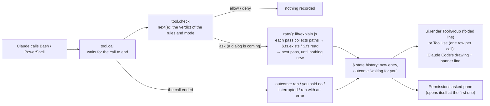

# shell-explainer

A Claude Code mod that explains every Bash or PowerShell command Claude asks permission to run, with a risk level, so you know what you're approving, and keeps a record of each one.

> **It explains; it doesn't protect.** The rating comes from fixed rules that can miss things or be misled. It never blocks a command or changes a permission decision. Always read the command itself before you approve it, especially a 🟢 or 🔵 one.

When the permission dialog opens for a shell command:

- **Under the command's line**, right above the dialog, one colored line with the risk level and the main reason. It shows only while the dialog waits: once you answer (or auto mode's classifier does), it leaves the transcript, and the pane keeps the record:
  ```
  ● Deleting the empty hello file
    $ Remove-Item -LiteralPath "C:\…\test\hello" -Confirm:$false
    ──────────────────────────────────────────────
    🟡 NEEDS YOUR ATTENTION — deletes ./test/hello
    ──────────────────────────────────────────────
  ```
- **The Permissions asked pane** records every one this session, newest first, one card each between thin rules: when it was asked and how it was answered, the risk level and reason, and the command. Paths read from the project (`.` is its folder, `..` the one above, `~` your home), and a leading `cd` into the project is left out. The answer is `… waiting`, `✓ approved` (it ran), `✗ denied` or `■ interrupted` (stopped at the dialog or while running; the two can't be told apart). `(auto)` after an approval or denial means auto mode's classifier decided it in your place. It's shown only when Claude Code's own record of the decision (the OpenTelemetry `tool_decision` event, matched to the command by its id) says so. Answered at the dialog, its source is `user_temporary`, `user_permanent`, `user_reject` or `user_abort`; settled without the dialog, it's `config`, which for a command that asked is auto mode's classifier, and the breakdown shows its own word for who decided (`Decided by: you, at the dialog (user_temporary)`); a permission the classifier hands to you is yours and has no mark, even in auto mode. The top line counts each, and **risky only** hides the 🟢 and 🔵 entries already answered. The newest shows its breakdown; **details** on any card shows that one instead:
  ```
  2 asked · 1 waiting · 1 denied                        risky only
  ────────────────────────────────────────────────────────────────
  18:21:07  … waiting                                 hide details
  🔴 HIGH RISK  force-push: replaces history on the remote (+2 more)
  git add -A && git commit -m wip && git push --force && rm -rf dist

    What it does
      1. git add -A
         stages changes for the next commit
      2. git commit -m wip
         records a commit
         ↳ only if 1 worked
      3. git push --force
         uploads commits to the remote
         ↳ only if 2 worked
      4. rm -rf dist
         deletes dist
         ↳ only if 3 worked

    Worth a look
      !! force-push: replaces history on the remote
      !! deletes dist and everything inside, without asking
      !  publishes commits to the remote, where others can see
         them

    Why it asked
      No allow rule matches this command.
  ────────────────────────────────────────────────────────────────
  18:19:42  ✗ denied                                       details
  🟡 NEEDS YOUR ATTENTION  deletes ./test/hello
  PowerShell: Remove-Item -LiteralPath ./test/hello -Confirm:$false
  ────────────────────────────────────────────────────────────────
  ```
  The pane opens by itself at the first permission asked. A pane a mod opens by itself is shown from 144 terminal columns (110 once you've opened it yourself), beside the transcript in a wide fullscreen terminal. `/shell-explainer` opens it at any width and gives it the keyboard; Esc closes it.

Commands your allow rules or permission mode approve never open a dialog, so they aren't recorded. The record lasts for the session; `/clear`, `/resume` and `/branch` start it over.

## Install

Needs Claude Code v2.1.287 or later (mods). In Claude Code:
```
/plugin marketplace add monraza/claudecodemod
/plugin install shell-explainer@shell-explainer
```
Then run `/reload-plugins`, or start a new session. `/plugin` lists it as `1 mod active · shell-explainer`.

To try it without installing: `claude --plugin-dir <path to this folder>`.

## Risk levels

The banner shows the highest level any part of the command reaches, and names the worst risk. The breakdown lists every risk, worst first: `!!` high, `!` attention, `·` low.

| Banner | When | Examples |
|---|---|---|
| 🟢 SAFE | Every part only reads | `git status`, `ls`, `cat`, `grep`, `jq` |
| 🔵 LOW RISK | Ordinary changes inside the project | `mkdir`, `git commit`, `npm run build`, `>` to a new file |
| 🟡 NEEDS YOUR ATTENTION | Can be undone but worth reading, goes beyond your machine, or isn't known | deleting one file, overwriting a file, `git push`, `gh pr create`, an unknown program, paths outside the project |
| 🔴 HIGH RISK | Hard or impossible to undo, or extra privileges | `rm -rf`, `git push --force`, `reset --hard`, `npm publish`, `curl … \| sh`, `sudo` |

Commands inside `$(…)`, `xargs`, `find -exec` and PowerShell's `ForEach-Object` are rated too.

### Scripts are rated by what they hold

A command that runs a script is rated by the script's contents, not just its name. Each risk found inside is named after the script it came from:

| Command | What's read |
|---|---|
| `npm run build`, `npm test`, `yarn build`, `pnpm lint` | The script in `package.json` (plus npm's `pre`/`post` scripts), rated as a shell command. Tools installed in `node_modules/.bin` (jest, eslint, …) count as the project's own. |
| `./deploy.sh`, `bash x.sh`, `source x.sh`, `./build.ps1`, `pwsh -File x.ps1` | The whole script, line by line. `if`, `for`, `case` and functions are shell syntax, not programs. Programs it doesn't know are named together, once. |
| `python seed.py`, `node gen.js` | The file is searched for calls that delete (`shutil.rmtree`, `fs.rm`), write, send data, or drop database tables. Commands it runs (`os.system`, `subprocess.run`, `execSync`) are rated like any command when they're written out. |

```
🔴 HIGH RISK — "build" script: deletes dist, ../shared and everything inside, without asking
  1. npm run build — runs the "build" script from package.json: rm -rf dist ../shared && tsc
```

A `cd` (or `pushd`, `Set-Location`) earlier in the command moves where later paths are read from, so `cd web && npm run build` reads `web/package.json`. A package script runs in its `package.json`'s folder. A folder that can't be told (`cd $DIR`, `cd -`) makes what's read there count as unreadable. `cd ..` counts as reaching outside the project.

A script that runs another script is followed, up to three deep. A script that can't be read is flagged 🟡, so nothing gets rated lower than before. For Python and JavaScript, only the file that runs is read, not the modules it imports.

## How it works



- **A mod, not a settings hook.** A settings hook's `PermissionRequest` message is never shown (Claude Code v2.1.292 parses it and drops it), and nothing can draw inside the permission dialog itself.
- **The banner goes under the command's line.** That line sits right above the dialog, and it's a render site a mod may change: usually a `ToolGroup` (the transcript folds shell calls into one line such as "Deleting the empty hello file"), or a `ToolUse` row where calls are drawn one per row (verbose mode, the ctrl+o transcript). Both are hooked. Writing the history into `$.state` redraws whichever reads it. The mod also calls `$.ui.notice`, the documented way to add a line under the dialog, but v2.1.292's terminal draws nothing for it under a shell command's dialog.
- **`tool.check`** fires after the permission rules and settings hooks have decided. Only an `ask` leads to a dialog, so the mod records nothing else. It never changes the verdict, and its `.catch` passes the verdict through if it fails.
- **What happened next** comes from the `tool.call` result. A refusal at the dialog has no flag of its own; it's read from the text the model gets ("doesn't want to proceed"), so the label is only as precise as that text.
- **`lib/explain.js`** is rule-based, offline and dependency-free (no Node inside a mod): no model call, no delay, no usage. It knows about a hundred common programs and cmdlets. A program it doesn't know is named as unknown, never guessed at. Whether a redirect overwrites a file is checked with `$.fs.exists`; anything it can't check counts as there, so a risk is never played down. The scripts a command runs are read with `$.fs.read`. A mod has no synchronous file system, so `rate()` runs `lib/explain.js` in passes: each pass asks for the files it needs, `$.fs` answers them, and the next pass uses the answers. It stops when a pass asks for nothing new (at most 5 passes). That way a `package.json` script that runs `./scripts/publish.sh` gets both read.
- In auto mode an `ask` goes to the classifier, which may approve it with no dialog. It's still recorded, with the outcome it got.

## Develop

```
npm test                       # Node tests for lib/explain.js, then the mod's tests
claude plugin validate .       # what Claude Code reads from the mod
claude --plugin-dir .          # run it, reloading on save
```

Tested with Claude Code 2.1.292.

## License

[MIT](LICENSE)
